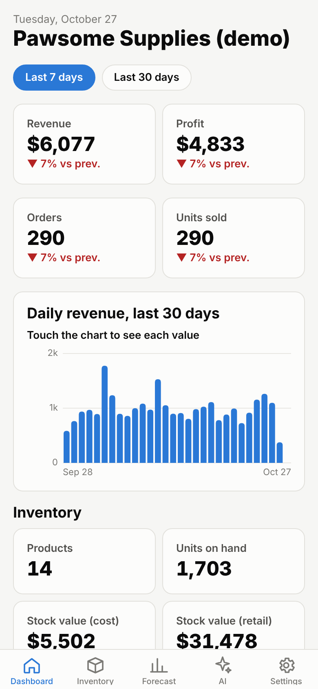
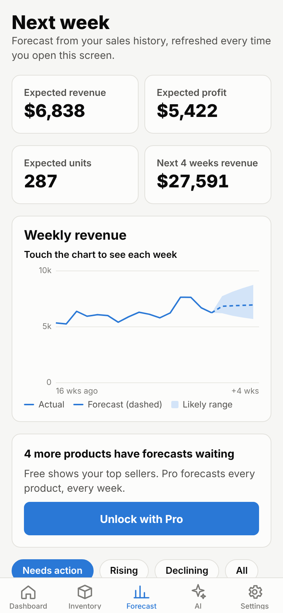
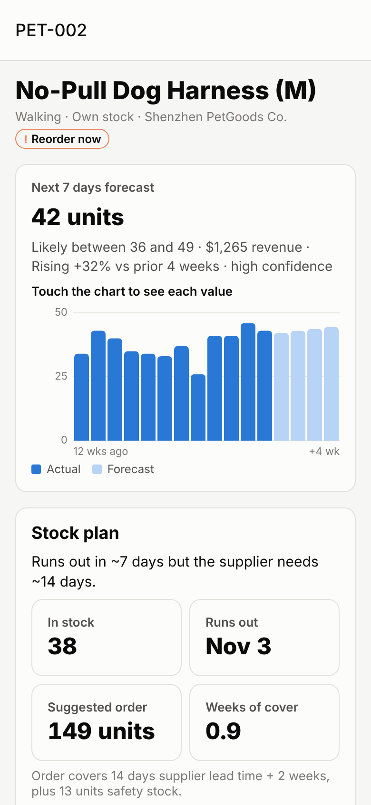
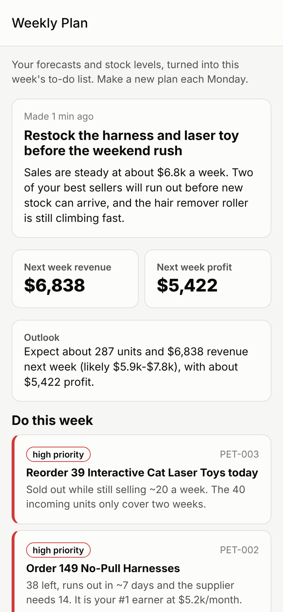

# StockPilot

An AI co-pilot for e-commerce and dropshipping sellers, built as an Android app for Google Play with a Pro subscription.

| Dashboard | Weekly forecast | Product + stock plan | AI Weekly Plan |
|---|---|---|---|
|  |  |  |  |

*(Screenshots use the built-in demo store. The Weekly Plan text in the last one is a hand-written sample, because no AI key was available when the screenshots were taken.)*

## What it does

**Inventory dashboard (no AI needed)**
- Revenue, profit, orders and units for the last 7 and 30 days, compared with the period before
- Daily revenue chart, revenue by channel (Shopify / TikTok / Amazon…)
- Stock on hand, stock value, out-of-stock, running-low and not-selling lists
- Add products by hand, record sales, receive stock, or import CSVs (Shopify exports work)
- Dropship items are handled separately: their stock figure is the supplier's

**Weekly demand forecast (statistics, so it's reliable and free to run)**
- For every product: expected units for each of the next 4 weeks, a likely range, the trend (rising / stable / declining) and how confident the forecast is
- It picks a method per product: a damped trend model for regular sellers, Croston's method for slow or lumpy sellers, and a weighted average for new products
- A week where a product was sold out is not counted as "zero demand", so best sellers don't get under-forecast
- A stock plan for each product: the date it runs out, whether to reorder now, and how many units to order (covers supplier lead time + 2 weeks + safety stock, minus stock already on order)

**AI features (Claude)**
| Feature | What the seller gets |
|---|---|
| **Weekly Plan** | The forecasts turned into a prioritised to-do list: what to reorder (with quantities), what to promote, what to clear, and expected revenue/profit for next week. The AI is only given the computed numbers and is told not to make up its own. |
| **Trend Scout** | Searches the web (TikTok Shop, Amazon Movers & Shakers, Google Trends, competitor stores) for the seller's niche and recommends 4–8 products to add, each with evidence, momentum, competition, price ranges, how to sell it, risks and source links. |
| **Product Check** | "Should I sell this?" Researches one product idea and returns go / test small / skip, with demand, competition and margin scores, red flags and a cheap test plan. |
| **Ask StockPilot** | A chat assistant that answers questions ("what should I reorder?", "what made the most profit this month?") by looking up the seller's live data with tools. |
| **Listing Writer** | SEO title, bullets, description, keywords and hashtags for Shopify, TikTok Shop, Amazon, eBay, Etsy or WooCommerce. |

**Free vs Pro**
- Free: dashboard, inventory, forecasts for the top 10 products, 3 AI requests a month
- Pro: forecasts for every product and up to 400 AI requests a month (a cap so one account can't run up an unlimited AI bill)
- These limits are set with environment variables (`FREE_AI_CALLS_PER_MONTH`, `FREE_FORECAST_PRODUCTS`). The Pro cap is `PRO_AI_CALLS_PER_MONTH` in `backend/app/billing.py`.

## How it's built

```
stockpilot/
├── backend/   Python FastAPI API: accounts, inventory, forecasting, Claude AI, subscriptions
│   ├── app/forecasting.py   forecast models + stock planning (pure functions, unit tested)
│   ├── app/services.py      dashboard numbers and per-product forecasts
│   ├── app/ai/              weekly_brief, trend_scout, product_check, assistant, listing
│   ├── app/billing.py       plans, AI quotas, RevenueCat webhook handling
│   └── tests/               21 tests (forecasting, API, AI flows with Claude faked out)
├── mobile/    Expo / React Native app (Android), Expo Router, react-native-svg charts
└── docs/      screenshots, sample CSVs
```

- **AI model:** `claude-opus-5-5` by default (change it with `CLAUDE_MODEL`). Requests turn on Anthropic's server-side fallback (`fallbacks: "default"`), so if a safety filter declines a request, the API automatically retries it on another model.
- **Subscriptions:** Google Play Billing through RevenueCat. The app links each purchase to the user's account ID, and RevenueCat's webhook tells the backend when Pro starts or ends. The server decides who has Pro, so a modified app can't unlock it.
- **Data:** SQLite by default. For production, set `DATABASE_URL` to Postgres (and install a Postgres driver such as `psycopg`).

## Run it locally

**Backend**
```bash
cd backend
python -m venv .venv && . .venv/bin/activate
pip install -r requirements-dev.txt
cp .env.example .env   # then fill in ANTHROPIC_API_KEY and JWT_SECRET
set -a && . ./.env && set +a
uvicorn app.main:app --reload --port 8000
pytest                 # runs the 21 tests; no API key needed
```
The API docs are served at http://localhost:8000/docs.

**App**
```bash
cd mobile
cp .env.example .env.local     # EXPO_PUBLIC_API_URL=http://10.0.2.2:8000 for the Android emulator
npm install
npx expo start
```
Sign up, then tap **Load demo store** to see every screen with realistic data.

## Launching on Google Play: checklist

1. **Deploy the backend** to any host that runs Docker (Railway, Render, Fly.io, Cloud Run…) using `backend/Dockerfile`. Set:
   - `ANTHROPIC_API_KEY`: from https://console.anthropic.com
   - `JWT_SECRET`: a long random string
   - `DATABASE_URL`: a Postgres URL (add `psycopg[binary]` to `requirements.txt`)
   - `REVENUECAT_WEBHOOK_SECRET`: any long random string (you paste the same one into RevenueCat in step 3)
   - `CORS_ORIGINS`: optional
2. **Google Play Console** ($25 one-time developer fee): create the app (package name `com.stockpilot.app`, or change it in `mobile/app.json`). Under *Monetize → Subscriptions*, create a subscription such as `stockpilot_pro` with a monthly plan (and a yearly one if you want).
3. **RevenueCat** (free until you earn $2.5k/month): create a project, add the Play app (this needs a Google Cloud service-account key; RevenueCat's guide walks you through it), create an entitlement named **`pro`**, attach your subscription products to it, and put them in the *current* offering. Under *Integrations → Webhooks*, point it to `https://YOUR-API/billing/revenuecat-webhook` and set the Authorization header to your `REVENUECAT_WEBHOOK_SECRET`.
4. **Build the app.** In `mobile/.env.local` (or as EAS environment variables), set `EXPO_PUBLIC_API_URL` to your deployed backend and `EXPO_PUBLIC_REVENUECAT_ANDROID_KEY` to the Google public SDK key from RevenueCat. Then:
   ```bash
   npx eas-cli@latest login
   npx eas-cli@latest build --platform android --profile production   # produces an .aab
   npx eas-cli@latest submit --platform android --profile production  # uploads to the internal testing track
   ```
5. **Store listing:** a privacy policy URL (required, because the app collects email addresses and sales data), the Data safety form, screenshots (`docs/screenshots` is a start), and the content rating. Test purchases with a licence-tester account on the internal track before you go live.

## What to build next
- Direct Shopify / WooCommerce / TikTok Shop sync (OAuth + webhooks), so nobody has to import CSVs
- A weekly push notification on Monday mornings: "Your plan is ready: 2 products need reordering"
- Scheduled Trend Scout runs for Pro users, with alerts when a new product starts trending
- Supplier management (several suppliers per product, price comparison, automatic purchase-order drafts)
- Ad-spend tracking, so profit numbers include marketing cost
